# NomadLink — Travel Agency Platform

NomadLink is a travel agency web application with a client front office and an admin back office. This part of the project covers **travel packs**, **discounts and price plans**, **Stripe payments and invoices**, **reward points with promo codes**, and an **AI travel assistant** built on a fine-tuned Llama 2 model.

### Technologies and tools

<p>
  
  
  
  
  
  
  
  
  
  
  
  
  
  
  
</p>

---

## Table of Contents

- [Features](#features)
- [Class diagram](#class-diagram)
- [Screenshots](#screenshots)
  - [Front office](#front-office)
  - [Stripe payment](#stripe-payment)
  - [Back office](#back-office)
  - [AI travel assistant](#ai-travel-assistant)
- [AI Model Fine-Tuning (Llama 2)](#ai-model-fine-tuning-llama-2)
- [Stripe Webhooks (local testing)](#stripe-webhooks-local-testing)

---

## Features

### Front office (client)
- Browse travel packs (Tunisia, Paris, Italy…) with a **sales countdown** and discount badges
- Book a pack and pay securely with **Stripe Checkout**
- View personal payment history
- Earn **reward points** and turn them into a **promo code** applied at checkout

### Back office (admin)
- Packs management: create, update and delete packs (type, image, flight, destinations and activities)
- **Discounts** with percentage and validity period
- **Price plans** linked to packs
- Payments list with **CSV export**
- Invoices list with links to the Stripe-hosted invoices
- Reward points management
- **Travel QA System**: AI assistant with knowledge base, knowledge upload, file operations and text generation

### Payments
- Stripe Checkout sessions with promotion codes
- Stripe webhooks (`/picloud/webhook`) to record payments and invoices automatically

---

## Class diagram

The diagram below summarizes the main NomadLink domain entities and their relationships.

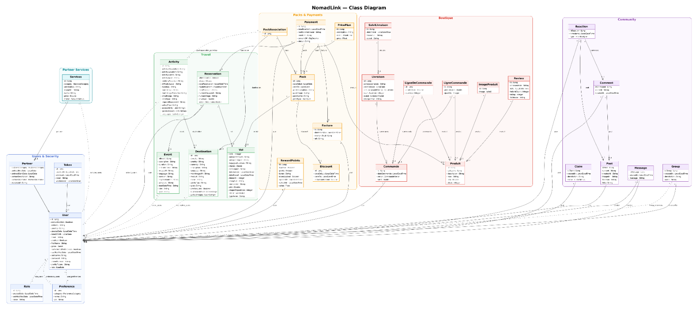

---

## Screenshots

### Front office

**Packs with sales countdown**

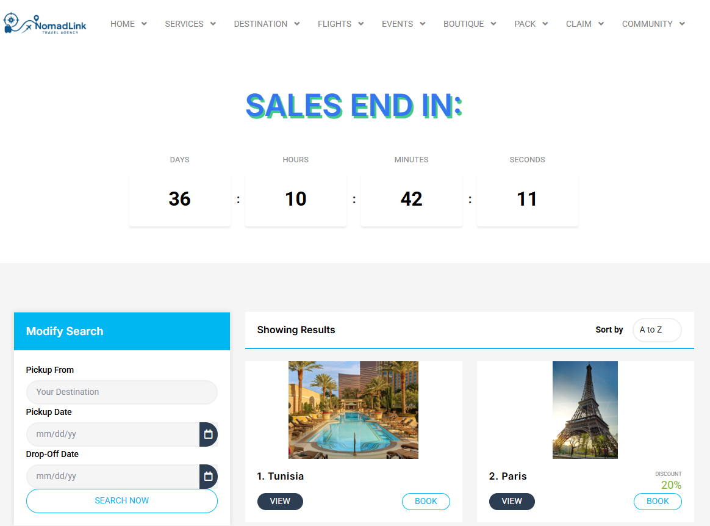

**My payments**

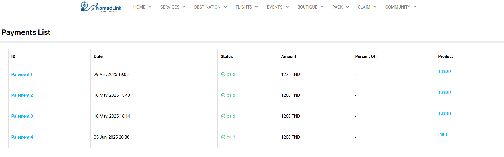

**Reward points and promo code**

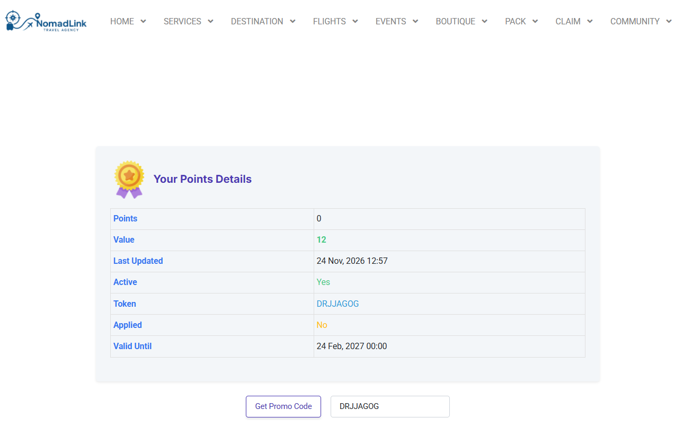

### Stripe payment

**Stripe Checkout with promo code applied**

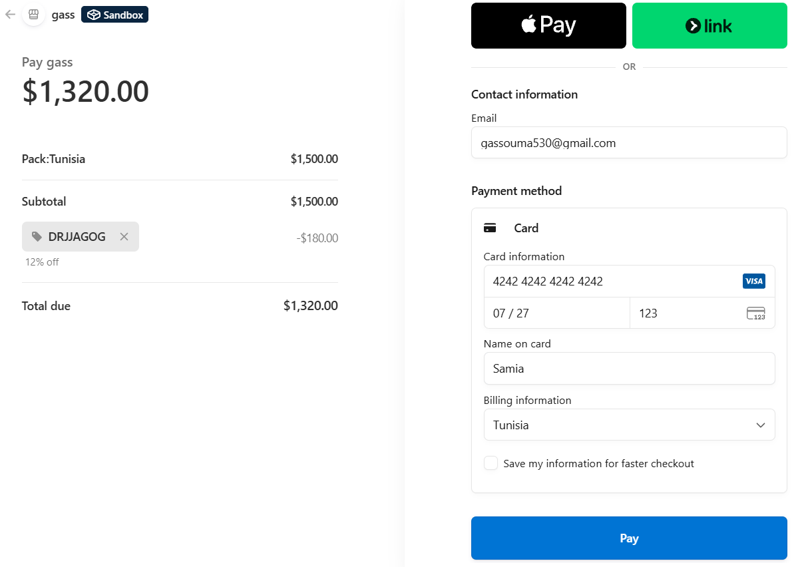

**Stripe CLI forwarding webhook events to the backend**

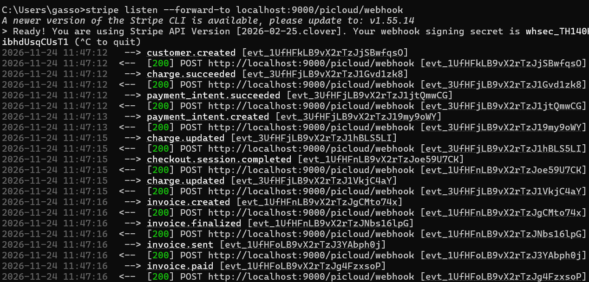

### Back office

**Packs management**

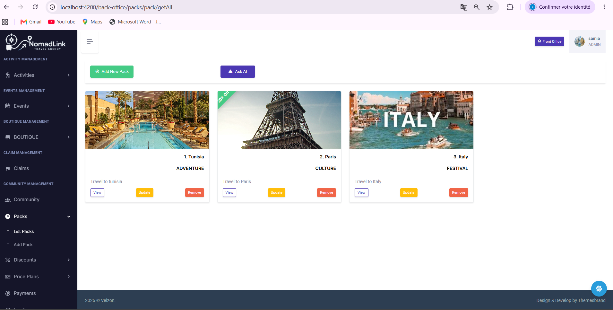

**Add / edit a pack**

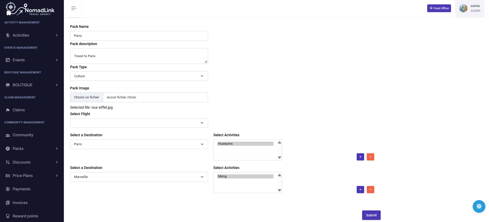

**Discounts**

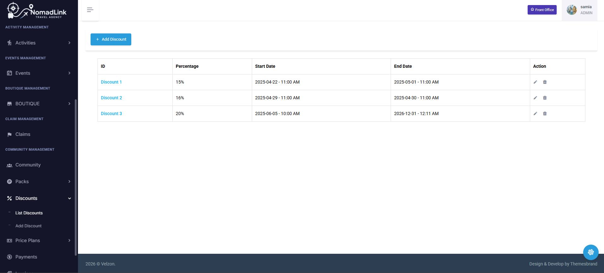

**Price plans**

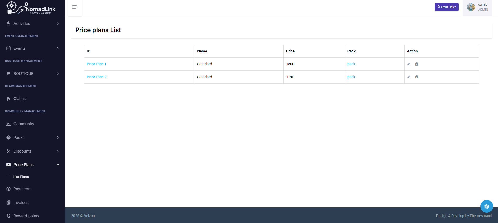

**Payments (with CSV export)**

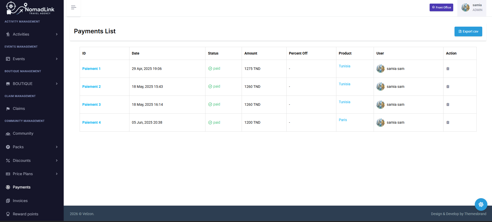

**Invoices**

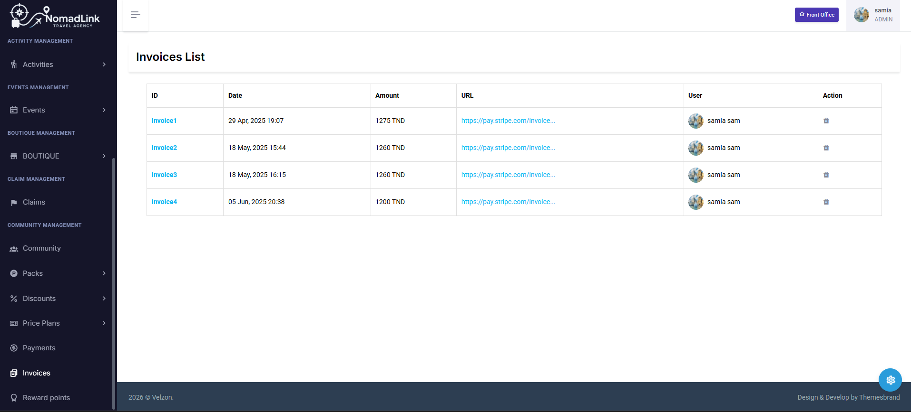

### AI travel assistant

**Travel QA System — chat with the fine-tuned model**

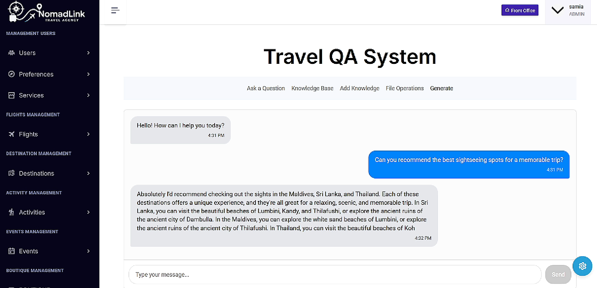

---

## AI Model Fine-Tuning (Llama 2)

The travel assistant uses a **Llama 2 7B Chat** model fine-tuned with **LoRA** (Parameter-Efficient Fine-Tuning) using Hugging Face `transformers`, `peft` and `trl`.

- **Model on Hugging Face:** [`samia4566/llama2-7B-finetuned-chat-guanaco`](https://huggingface.co/samia4566/llama2-7B-finetuned-chat-guanaco)
- **Notebook:** `LLAMA_2.ipynb`

### Setup

| Item | Value |
|---|---|
| Base model | [`NousResearch/Llama-2-7b-chat-hf`](https://huggingface.co/NousResearch/Llama-2-7b-chat-hf) |
| Dataset | [`mlabonne/guanaco-llama2-1k`](https://huggingface.co/datasets/mlabonne/guanaco-llama2-1k) (1,000 instruction samples) |
| Method | Supervised Fine-Tuning (`SFTTrainer`) + LoRA adapters |
| Prompt format | `<s>[INST] {prompt} [/INST]` |

### LoRA configuration

| Parameter | Value |
|---|---|
| `r` | 64 |
| `lora_alpha` | 16 |
| `lora_dropout` | 0.1 |
| `bias` | none |
| `task_type` | CAUSAL_LM |

### Training hyperparameters

| Parameter | Value |
|---|---|
| Epochs | 3 |
| Batch size (per device) | 8 |
| Gradient accumulation steps | 1 |
| Optimizer | AdamW (`adamw_torch`) |
| Learning rate | 2e-5 (constant scheduler) |
| Warmup ratio | 0.03 |
| Weight decay | 0.01 |
| Max grad norm | 0.3 |
| Max sequence length | 512 |
| Mixed precision | fp16 |
| Gradient checkpointing | enabled |
| Group by length | enabled |
| Logging | TensorBoard, every 25 steps |
| Checkpoints | every 50 steps, pushed to the Hugging Face Hub |

### Results

Final values from TensorBoard:

| Metric | Value |
|---|---|
| Epochs completed | 3 |
| Training steps | 441 |
| Training loss | 2.52 → **2.01** |
| Mean token accuracy | 0.51 → **0.568** |
| Gradient norm | ~0.13 |
| Tokens processed | ~1.16 M |

The loss goes down steadily and the token accuracy goes up across the three epochs, with no sign of training instability.

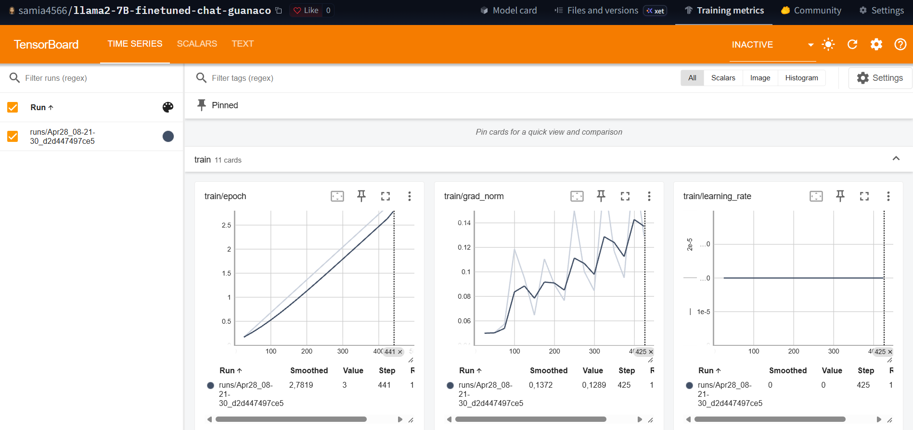

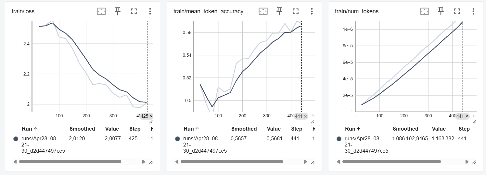

### Inference example

```python
from transformers import pipeline

pipe = pipeline("text-generation", model=model, tokenizer=tokenizer, max_length=192)
prompt = "Can you recommend the best sightseeing spots for a memorable trip?"
result = pipe(f"<s>[INST] {prompt} [/INST]")
print(result[0]["generated_text"])
```

---

## Stripe Webhooks (local testing)

Install the [Stripe CLI](https://docs.stripe.com/stripe-cli), then forward events to the backend:

```bash
stripe login
stripe listen --forward-to localhost:9000/picloud/webhook
```

Copy the `whsec_...` signing secret printed by the CLI into the backend configuration. Use Stripe test cards (for example `4242 4242 4242 4242`) to simulate payments.

> ⚠️ Never commit Stripe secret keys or webhook signing secrets to GitHub.
